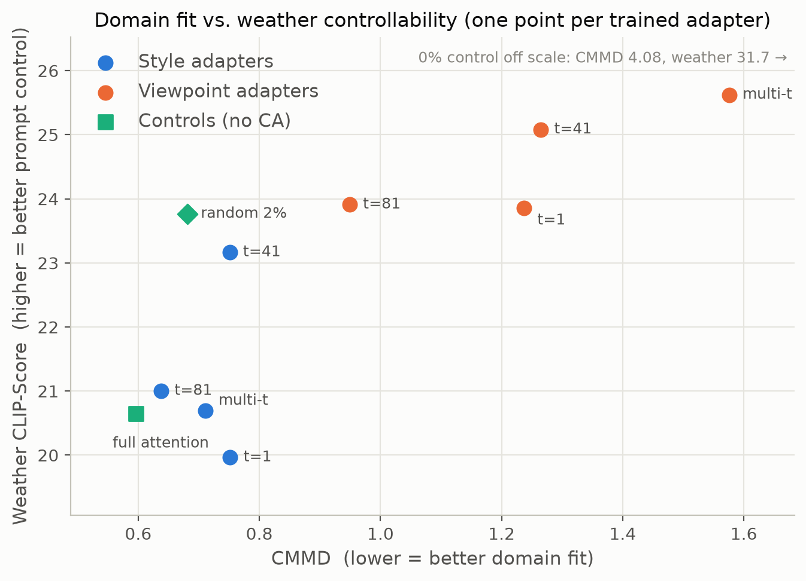

# Improving CA-LoRA

A full reimplementation of **CA-LoRA** (Concept-Aware LoRA, CVPR 2025, [arXiv:2503.22172](https://arxiv.org/abs/2503.22172) — no official code) on SDXL + Cityscapes, which replaces the paper's heuristic choice of the CA-measurement timestep (t = 81) with a quantitative gradient-direction criterion, and adds multi-timestep aggregation and a training-time CA drift analysis.

## TL;DR

- **The reproduction succeeds.** All 4 selection pairs reproduce the style/viewpoint signature of the paper's Figure 6: style adapters win domain fit, viewpoint adapters preserve weather-prompt controllability.
- **The quantitative timestep criterion reveals a metric-dependent trade-off, not a single best t.** The paper's heuristic t = 81 stays best on CMMD (domain fit), while the criterion's winner t = 41 and the multi-t aggregate win weather-prompt controllability. *Honesty note:* a random 2% control matches or beats most CA runs on CMMD — the value of CA selection lies on the controllability-preservation side, and the report discusses this openly.
- **The CA selection does not survive its own training.** The selected heads are pushed out of the top-2% within ~500 steps. This is boundary competition, not CA collapse: the global CA ranking stays largely intact.



*Domain fit (CMMD, lower is better) vs. weather-prompt controllability (CLIP-Score, higher is better): no trained adapter wins both.*

## Pipeline

Six commands — the report's five stages, with generation and evaluation as their two separate scripts. Stages 1–3 (measurement, timestep ranking, selection) run under `configs/tsweep_sdxl.yaml`, the 13-timestep sweep; stages 4–6 (training, generation, evaluation) run under `configs/sdxl_cityscapes.yaml`, the paper-reproduction config. `tsweep_sdxl.yaml` inherits from `sdxl_cityscapes.yaml` and only overrides the measurement grid, so the two share every model, data, and training setting. Set `data.root` in `configs/sdxl_cityscapes.yaml` to your Cityscapes directory first.

```bash
# 1. CA measurement over the 13-timestep grid -> runs/tsweep_sdxl/measurements/t*.safetensors
python scripts/measure_ca.py --config configs/tsweep_sdxl.yaml

# 2. Rank timesteps by ews (direction criterion) -> runs/tsweep_sdxl/timestep_scores.json
python scripts/score_timesteps.py --config configs/tsweep_sdxl.yaml

# 3. Selection: one JSON per arm, 208 head units each (top 2% of 10,400).
#    All arms read the same measurements, so they differ only in the selection.
python scripts/select_projections.py --config configs/tsweep_sdxl.yaml \
    --strategy single --timesteps 41 --set select.axis=style --out selection_t41_style.json
python scripts/select_projections.py --config configs/tsweep_sdxl.yaml \
    --strategy aggregate --from-scores --set select.top_timesteps=3 select.axis=style \
    --out selection_multi_t_style.json
python scripts/select_projections.py --config configs/tsweep_sdxl.yaml \
    --strategy random --seed 0 --out selection_random.json   # controls: --strategy all = full attention

# 4. Train one arm (10k steps; CA drift snapshots ride along every 500 steps)
python scripts/train_lora.py --config configs/sdxl_cityscapes.yaml \
    --selection runs/tsweep_sdxl/selection_t41_style.json --run-name t41_style

# 5. Generate 900 images for the arm (500 in-domain + 4 weather conditions x 100)
python scripts/generate_images.py --config configs/sdxl_cityscapes.yaml \
    --lora runs/sdxl_cityscapes/t41_style/lora-final.safetensors \
    --run-name t41_style --mode both

# 6. CMMD + CLIP-Score -> runs/sdxl_cityscapes/t41_style/eval.json
python scripts/evaluate.py --config configs/sdxl_cityscapes.yaml --run-name t41_style
```

Repeat stages 3–6 per arm; the full run matrix is {t = 81, t = 41, t = 1, multi-t [41, 1, 81]} x {style, viewpoint} plus the random and full-attention controls. Every script takes `--config` and accepts dotted overrides via `--set key=value`. `scripts/check_drift_autocast_gate.py` is the one-off gate that validates the bf16 drift snapshots against fp32 before training (its thresholds are fixed in code).

## Setup

Python >= 3.10. The core library (CA engine, selection, sliced LoRA, tests) needs only PyTorch, NumPy, safetensors, PyYAML and Pillow; the real SDXL runs additionally need diffusers/transformers:

```bash
pip install -e .              # core
pip install -e ".[diffusion]" # + diffusers, transformers (needed for SDXL runs)
pip install -e ".[dev]"       # + pytest, matplotlib (full test suite without skips)
```

Verification without a GPU:

```bash
python -m pytest tests/ -q     # CPU, seconds
python scripts/smoke_test.py   # whole pipeline end-to-end on a toy UNet (configs/tiny_cpu.yaml)
```

The reported experiments ran on a single A100 80GB. Cityscapes must be obtained separately from [cityscapes-dataset.com](https://www.cityscapes-dataset.com/) (it is not redistributable); see `src/calora/data/cityscapes.py` for the expected `leftImg8bit/` + `gtFine/` layout.

## Repository structure

```
configs/        sdxl_cityscapes.yaml (reproduction), tsweep_sdxl.yaml (13-t sweep),
                tiny_cpu.yaml (CPU toy), prompt_augmentations.json (the paper's c_Aug templates)
scripts/        the six pipeline stages + smoke_test.py and the drift autocast gate
src/calora/     ca/ (measurement, statistics, selection), models/ (projection table, sliced LoRA,
                SDXL + toy adapters), train/, eval/ (CMMD, CLIP-Score), analysis/ (CA drift), data/
tests/          unit tests for every invariant (batch=1, pairing, head slicing, checkpoint metadata)
figures/        the four report figures
results/        experiment raw artifacts backing the report tables (with sha256 manifest)
REPORT.md       the full research report
PREREGISTRATION.md   pre-registered decisions and their deviations
```

## Report and provenance

- **[REPORT.md](REPORT.md)** — the full research report: method, setup, results, discussion, limitations.
- **[PREREGISTRATION.md](PREREGISTRATION.md)** — the decisions fixed before measurement (primary metric, demotion rule, aggregation width, autocast gate thresholds) and every deviation from them.
- **[results/MANIFEST.md](results/MANIFEST.md)** — artifact manifest: sha256 for each released artifact, plus the Hugging Face locations of the large files that are too big for git — LoRA checkpoints at [huggingface.co/chs35/improving-ca-lora-checkpoints](https://huggingface.co/chs35/improving-ca-lora-checkpoints), CA measurement safetensors and generated images at [huggingface.co/datasets/chs35/improving-ca-lora-artifacts](https://huggingface.co/datasets/chs35/improving-ca-lora-artifacts), with their full sha256 lists in `results/sha256_checkpoints.txt`, `results/sha256_measurements.txt` and `results/sha256_generated_images.csv`.
- **`scripts/make_figures.py`** regenerates the four figures from `results/`.
